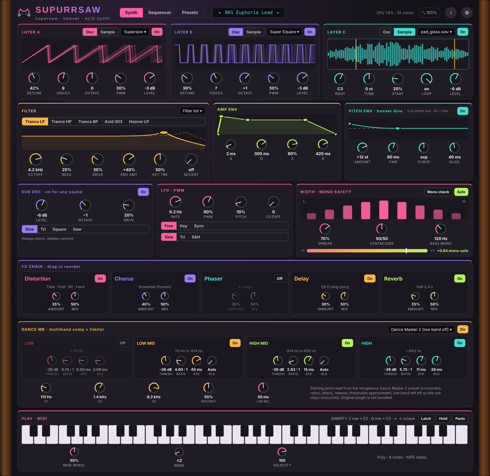

<p align="center"></p>

# SupurrSaw 🐈🎹

A free, open source supersaw, hoover and acid synth for **Linux, Windows and macOS** (VST3 and standalone app, built from one codebase).

> Status: first release candidate. The engine is tested offline, and the VST3 and standalone are built for Linux, Windows and macOS (Apple silicon) by GitHub Actions. Not signed yet, see the install steps in the release notes.

By **Studio 87**.

**Download:** the latest release has one zip with a real installer for Windows, macOS (Apple silicon) and Linux, plus a PDF manual. Works in any DAW that loads VST3 (Ableton Live, Bitwig, Reaper, FL Studio, Studio One, Cubase and others).

**Good for:** free VST3 supersaw synth, trance and hardstyle leads, hoover and rave stabs, acid bass, supersaw chords, JP-8000 style supersaw sound. Linux VST3 synth, Windows VST3 synth, macOS VST3 synth.

**Manual:** [PDF with interface tour, opens in the browser](https://github.com/SpeakingColors/SupurrrSaw-VST/blob/main/docs/SupurrSaw_Manual.pdf)

<p align="center"><br><sub>Screenshot of the interactive mockup in docs/mockups.</sub></p>

## What it does

- **3 layers.** Each one is an oscillator or a loaded sample: Super Saw (JP-8000 style), Super Square (PWM), Saw, Pulse, Triangle, Sine, Sample.
- **0% detune gives one clean oscillator.** Push the detune range further than the original when you want.
- **Sub oscillator** you can switch on for any sound.
- **Hoover:** pitch envelope dive, PWM and an LFO on the pulse width and on the detune.
- **Hard sync** with a sweepable slave (envelope and LFO) for talking leads.
- **Noise** with its own high-pass, and **distortion before or after the filter** (screech).
- **Acid:** 18 dB and 24 dB ladder filters, plus HP and BP, an acid mode and a second filter.
- **Mono safe:** low frequencies are summed to mono, and the engine checks the mono sum.
- **Mod matrix, three LFOs and drawn envelopes**, wave lab with single-cycle waves you draw yourself.
- **FX:** drive and crush, mod FX (chorus, flanger and phaser, each remembers its own settings), delay, reverb, opto leveller, OTT, squeeze, dance master, limiter. The displays show what each one does.
- **Pitch wheel, mod wheel and MPE.** Pitch bend with a range of 1 to 24 semitones, mod wheel to anything in the matrix, and MPE (per-note bend, pressure and slide) so one note of a chord can bend alone. Pressure, Slide and Bend are sources in the mod matrix.
- **Drag to modulate.** Open the Mod tray, drag a source (LFO, envelope, wheel, pressure and so on) onto a knob and set the amount, like Serum 2 and Vital. Rings on the knob show what moves it.
- **Kit mode:** play drum kits from the keyboard (built-in genre kits, edit your own on the Kit page).
- **180+ presets** in banks A to G (128 slots each), with favorites, your own order, search and tags.
- **Factory banks:** `presets/factory/` holds SysEx files with the factory banks A to D. Import them on the Presets page (Banks, Import .syx) to get the factory sounds back after you overwrite a bank, or use **Restore factory** on the same page.

## Build the plugin

The plugin is in `plugin/` (JUCE 8). Its window is the SupurrSaw interface from `ui/supurrsaw-playground.html`, shown in a web view, with the fonts bundled so it works offline. The sound comes from the same C++ engine as the tests.

```
cmake -S plugin -B build -DCMAKE_BUILD_TYPE=Release
cmake --build build --config Release
```

Linux needs the usual JUCE packages plus `libwebkit2gtk-4.1-dev` and `libgtk-3-dev`. Windows uses WebView2 (included in Windows 10 and 11). GitHub Actions builds all three systems on every push: open the **Actions** tab, pick the latest run of **build plugin**, and download the artifact for your system.

Presets, saved waves, exports and the log live in your user folder under `Studio 87/SupurrSaw`. The **Files** button in the plugin opens them.

## Try the engine today

```
g++ -O2 -std=c++17 -o demo tools/demo.cpp
./demo            # renders hoover, acid, reese and supersaw demos as WAV files
g++ -O2 -std=c++17 -o presets_test tools/presets_test.cpp && ./presets_test .   # renders and checks the built-in presets
```

## Samples and copyright

The built-in `assets/samples/choir_stab_classic.wav` was made by Studio 87 and ships with the synth. Third-party sample packs must never be committed; put those in your local waveform library.

## Licence

AGPL-3.0-or-later (the JUCE framework is used under the AGPLv3). You can use, change and share it, and anyone who shares a modified version must share the source under the same terms.

Free to use.

<p align="center">
  <a href="https://ko-fi.com/studio87"></a>
</p>

☕ Free and open source, made by one person. If it helps your music, a coffee on [Ko-fi](https://ko-fi.com/studio87) keeps it coming. 💜

Not affiliated with or endorsed by Roland, Korg or any other brand mentioned. Names are used only to describe sounds and compatibility.

## Docs
- [Interactive mockups](docs/README.md)
- [Roadmap](ROADMAP.md)
